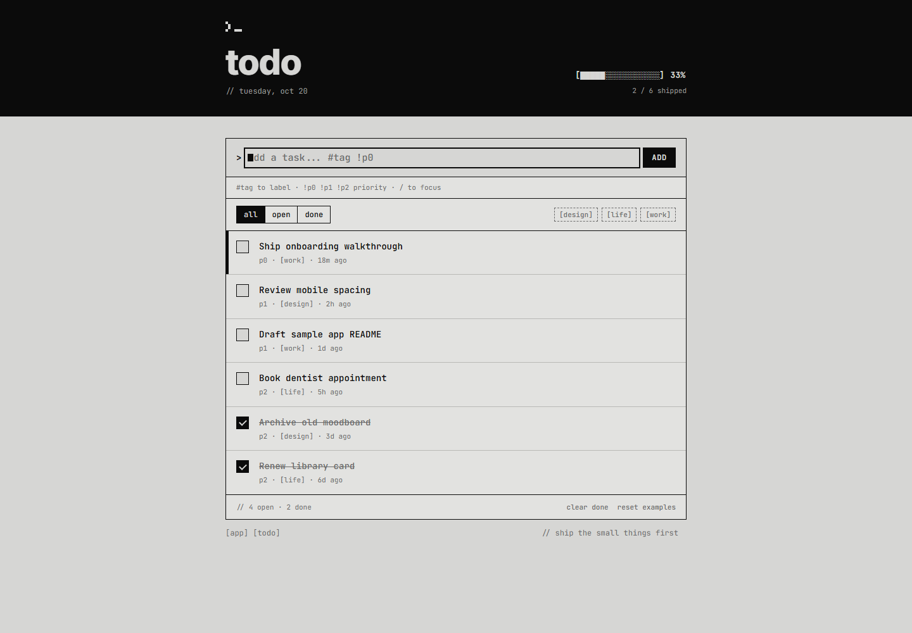
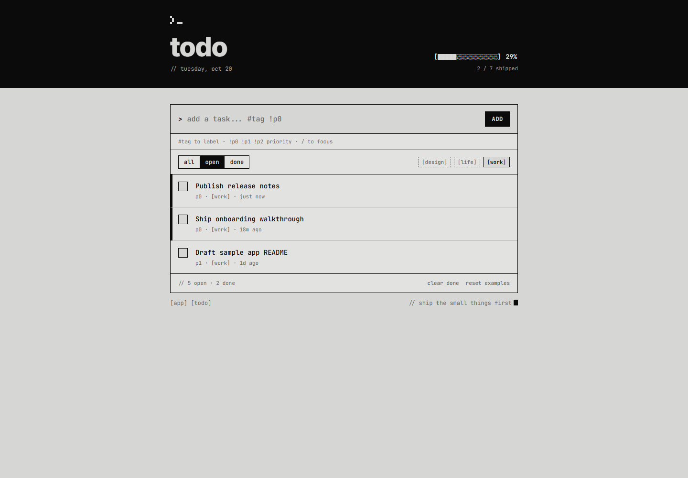
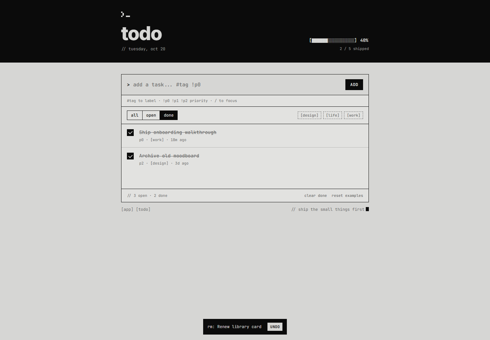
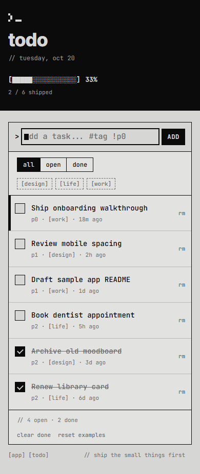

# Sample Apps

A growing collection of polished, self-contained sample applications.

## Command Line Todo

A keyboard-first task list with a strict monochrome command-line visual system. The app is contained in a single HTML file, requires no build step, and stores changes in the browser.



### Run the app

Open [`samples/command-line-todo/index.html`](samples/command-line-todo/index.html) directly in a browser, or serve it locally:

```powershell
python -m http.server 8000 --bind 127.0.0.1 --directory .\samples\command-line-todo
```

Then open <http://127.0.0.1:8000>.

### Add tasks with command-line syntax

Type the task description followed by an optional tag and priority:

```text
Publish release notes #work !p0
```

| Syntax | Result |
| --- | --- |
| `#tag` | Labels the task and creates a reusable tag filter. Defaults to `general`. |
| `!p0` | Highest priority. Open `p0` tasks receive an urgent marker. |
| `!p1` | Medium priority. |
| `!p2` | Standard priority and the default when no priority is entered. |

Tasks are automatically sorted with open items first, then by priority, and then by newest creation time.



### Features

| Area | Included behavior |
| --- | --- |
| Task management | Add, complete, reopen, and remove individual tasks. |
| Bulk actions | Clear every completed task or restore the original example data. |
| Undo | Restore a deleted task or reverse a bulk clear from the temporary notification. |
| Organization | Parse `#tags`, assign `p0`-`p2` priorities, and sort the queue automatically. |
| Filtering | Switch between all, open, and done tasks; combine status views with a tag filter. |
| Progress | Show open/done counts, shipped totals, a 16-cell completion meter, and percentage. |
| Persistence | Save tasks to `localStorage`; continue in memory if browser storage is unavailable. |
| Time | Display relative creation times and refresh visible timestamps every 30 seconds. |
| Empty states | Provide specific guidance for empty lists, open queues, completed queues, and tag filters. |
| Keyboard | Press `/` outside a text field to focus the prompt and `Escape` to release focus. |
| Responsive layout | Reflow the header, filters, task rows, and footer actions for narrow screens. |
| Accessibility | Use semantic forms and buttons, checkbox roles, accessible labels, live regions, focus styles, and reduced-motion support. |
| Motion | Animate initial loading, task entry and token parsing, progress updates, completion, sorting, deletion, undo, cursors, hover scanlines, and live meter changes. |

### Complete, remove, and undo

Checking a task updates its status, position, totals, and progress meter. Removed tasks and cleared completed tasks can be restored while the `UNDO` notification is visible.



### Mobile layout

The same controls and task details remain available on small screens, with the summary, filters, rows, and footer actions reflowed for touch-sized layouts.


